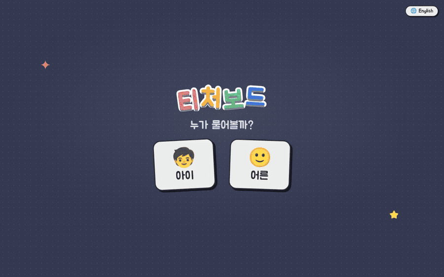
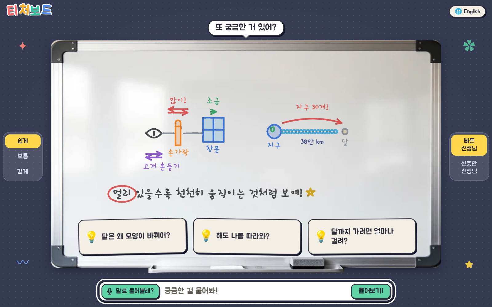
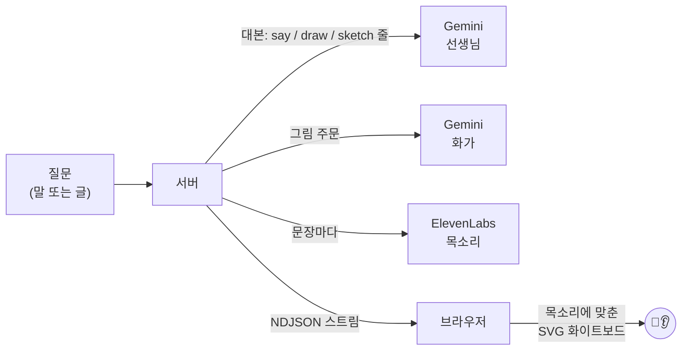

<p align="center">
  
</p>

<p align="center">
  <b>묻기만 하면, 화이트보드 앞 AI 선생님이 말로 설명하면서 칠판에 그려 줘요. 목소리와 판서가 딱 맞춰서.</b>
</p>

<p align="center">
  <a href="README.md">English</a> · <b>한국어</b> · <a href="README.zh-CN.md">简体中文</a>
</p>

<p align="center">
  <a href="LICENSE"></a>
  
  
  
</p>

<p align="center">
  
</p>

<p align="center"><sub>2배속, 소리 없음. ▶ <a href="docs/media/demo-ko.mp4">선생님 목소리와 함께 전체 수업 보기(MP4)</a></sub></p>

---

## 이런 앱이에요

티처보드는 가족용 작은 웹 앱이에요. 아이(또는 어른)가 말이나 글로 *"달은 왜 나를 따라와?"* 하고 물으면, 화이트보드 앞 선생님이 진짜 수업처럼 답해 줘요.

- **말하면서 동시에 그려요.** 문장을 말하는 동안 마커가 제목을 쓰고, 그림을 그리고, 화살표를 긋고, 핵심 낱말을 말하는 바로 그 순간에 동그라미를 쳐요.
- **꾸밈 그림이 아니라 설명 그림.** 따로 있는 "화가" 모델이 나란히 비교, 원인 → 결과 화살표, 속을 잘라 보기처럼 원리가 한눈에 보이는 그림을 그려요.
- **말로 묻고, 중간에 끼어들기.** 음성 인식이 진짜 질문만 골라내고 "우와!", 형제끼리 하는 말, 선생님 목소리는 걸러요. 수업 중에 *"근데 왜?"* 하고 끼어들 수 있어요.
- **이어 묻기 카드.** 수업이 끝나면 "다음엔 이걸 물어볼까?" 카드 2~3개가 떠요.
- **한국어와 영어.** 🌐 버튼으로 바꾸면 화면·수업·목소리·음성 인식이 모두 따라 바뀌어요.
- **아이를 위해.** 아이·어른 프로필, 설명 수준 세 가지(쉽게·보통·깊게), 무서운 주제는 부드럽게, 휴대폰으로 열 때는 가족 비밀번호.

<p align="center">
  
</p>

## 어떻게 돌아가나요



1. **선생님** 모델(Gemini)이 수업 대본을 JSON Lines로 흘려보내요: 말할 문장, 칠판에 그릴 것, 그림 주문.
2. **화가** 모델이 주문받은 그림을 마커 선으로 그려요. 수업이 이미 시작된 뒤에도 나란히 그려요.
3. **ElevenLabs**가 문장마다 목소리와 글자별 시각을 만들어서, 판서가 정확히 그 낱말에서 시작돼요(`"at": "산"`).
4. 브라우저는 SVG 화이트보드에 사람 손 빠르기로 한 획씩 그려요.

선생님은 두 가지: **빠른 선생님**(Gemini Flash, 2~3초면 첫 말, 그림은 화가가)과 **신중한 선생님**(더 큰 Gemini가 먼저 생각해서 15~25초, 그림도 직접).

## 빠르게 시작하기

**Node.js 22 이상**, **Gemini API 키**([Google AI Studio](https://aistudio.google.com/)), **ElevenLabs API 키**와 목소리 ID 두 개가 필요해요.

```bash
git clone https://github.com/doppingkim/teacherboard.git
cd teacherboard
npm install
cp .env.example .env      # 꼭 필요한 값 네 개를 채워요
npm run dev               # → http://localhost:5173
```

`.env`:

```
GEMINI_API_KEY=...
ELEVENLABS_API_KEY=...
ELEVENLABS_VOICE_KID=...
ELEVENLABS_VOICE_ADULT=...
```

목소리를 고르기 전에 샘플을 들어 보려면(`ELEVENLABS_API_KEY`만 있으면 돼요) 아래를 실행하고 `data/samples/*.mp3`를 들어 봐요.

```bash
npx tsx scripts/voice-samples.ts <voiceId> <voiceId> ...
```

키 없이 칠판만 보고 싶으면 `http://localhost:5173/?demo=1`을 열어요(고정 판서 데모).

### 운영 빌드

```bash
npm run build
npm start                 # → http://localhost:8787
```

### Docker

```bash
docker build -t teacherboard .
docker run --env-file .env -p 8787:8787 teacherboard
```

컨테이너는 `0.0.0.0`에서 열리므로 `FAMILY_PIN`이 없으면 켜지지 않아요(아래 참고).

## 휴대폰·아이패드에서 쓰기

브라우저는 **HTTPS**에서만 마이크를 열어 줘요. 가장 쉬운 방법은 내 컴퓨터에서 터널을 여는 거예요.

**ngrok** (휴대폰에 앱 설치 필요 없음)

1. ngrok.com에서 무료 고정 도메인을 받고, `ngrok config add-authtoken <토큰>`을 한 번 실행해요.
2. `.env`에 적어요.
   ```
   ALLOWED_HOSTS=내이름.ngrok-free.app
   FAMILY_PIN=123456
   PIN_SECRET=<32자 이상 무작위 문자열>
   TRUST_PROXY=1
   ```
3. `npm run build`, `npm start` 후, 다른 터미널에서 `ngrok http 8787 --url=내이름.ngrok-free.app`.
4. 휴대폰에서 `https://내이름.ngrok-free.app`을 열고 "홈 화면에 추가"를 하면 앱처럼 써요.

**Tailscale**도 돼요: `tailscale serve --bg 8787` 후, `<PC이름>.<tailnet>.ts.net`을 `ALLOWED_HOSTS`에 적어요.

`http://<PC의 IP>:8787`로 열면 글자로만 물을 수 있어요.

### 가족 비밀번호

서버를 밖에 열면 숫자 6자리 `FAMILY_PIN`이 모르는 사람이 내 API 키를 쓰지 못하게 막아요. 기기마다 한 번 누르면 1년 동안 기억해요(`PIN_SECRET`을 정해 두면 서버를 다시 켜도 기억해요). 틀리면 방문자마다 잠기고, 전체·하루 한도도 따로 있어요. `ALLOWED_HOSTS`, `TRUST_PROXY`, 이 컴퓨터가 아닌 `HOST` 중 하나라도 있으면 비밀번호 없이는 서버가 켜지지 않아요.

## 설정 값

| 이름 | 기본값 | 설명 |
| --- | --- | --- |
| `GEMINI_API_KEY` | — | **필수.** 선생님·화가·질문 판별 |
| `ELEVENLABS_API_KEY` | — | **필수.** 목소리·음성 인식 |
| `ELEVENLABS_VOICE_KID` / `_ADULT` | — | **필수.** 프로필별 목소리 ID |
| `ELEVENLABS_VOICE_KID_EN` / `_ADULT_EN` | 위와 같음 | 영어 수업용 목소리를 따로 쓸 때 |
| `PORT` | `8787` | 서버 포트 |
| `HOST` | `127.0.0.1` | 다른 기기에서 열려면 `0.0.0.0`(`FAMILY_PIN` 필요) |
| `FAMILY_PIN` | 비어 있음 | 가족 비밀번호(숫자 6자리) |
| `PIN_SECRET` | 켤 때마다 무작위 | 쿠키 서명 비밀(32자 이상) |
| `TRUST_PROXY` | 꺼짐 | 이 컴퓨터의 터널(ngrok, tailscale serve)을 믿기 |
| `ALLOWED_HOSTS` | 비어 있음 | 추가로 허용할 주소, 쉼표로 구분 |
| `LOG_TEXT` | 켜짐 | `0`이면 질문 원문 대신 글자 수만 기록 |
| `QUICK_MODEL` / `DEEP_MODEL` | `gemini-3.8-flash` / `gemini-4-neon` | 선생님 모델 |
| `ARTIST_MODEL` | `gemini-3.8-flash` | 화가 모델 |
| `CLASSIFY_MODEL` | `gemini-3.5-flash-lite` | "질문인가?" 판별 모델 |

모델마다 생각 수준도 정할 수 있어요: `QUICK_THINKING`, `DEEP_THINKING`, `ARTIST_THINKING`, `CLASSIFY_THINKING`.

## 언어

🌐 버튼으로 한국어 ↔ English를 바꾸고, 기기마다 기억해요. 처음에는 브라우저 언어를 따르고, 주소에 `?lang=ko`나 `?lang=en`을 붙이면 그 언어로 열려요. 화면 글씨, 칠판 손글씨 글꼴, 수업 언어, 음성 인식, 선생님이 생각하는 동안 나오는 짧은 말까지 함께 바뀌어요.

## 비용과 개인정보

- 수업 하나에 선생님 호출 1번, 화가 호출 최대 5번, 문장마다 목소리 1번이 들어요. 긴 지시문은 Gemini가 알아서 캐시해요.
- API 키는 서버 안에만 있고 브라우저나 로그로 나가지 않아요.
- 부모가 볼 수 있게 서버 로그에 질문이 남아요. `LOG_TEXT=0`이면 글자 수만 남아요.
- `npx tsx scripts/latency-report.ts server.log --last 50`으로 로그에서 속도와 사용량을 요약해 볼 수 있어요.

## 개발

```bash
npm test             # 단위 테스트(Vitest)
npm run e2e          # 브라우저 테스트(Playwright, 픽스처로 — API 호출 없음)
npm run typecheck
```

실제 API로 확인하는 도구는 `scripts/`에 있어요(`smoke-teacher.ts`, `smoke-artist.ts`, `smoke-classify.ts`, `smoke-listen.ts`). 주소에 `?fps=1`을 붙이면 판서 프레임 수가 보여요.

```
src/server   Fastify 서버: 수업 스트림, 화가, 목소리, 음성 인식, 가족 비밀번호
src/web      브라우저: SVG 화이트보드, 재생기, 마이크, 화면
src/shared   둘이 함께 쓰는 대본 형식과 타입
```

## 라이선스

[MIT](LICENSE)
