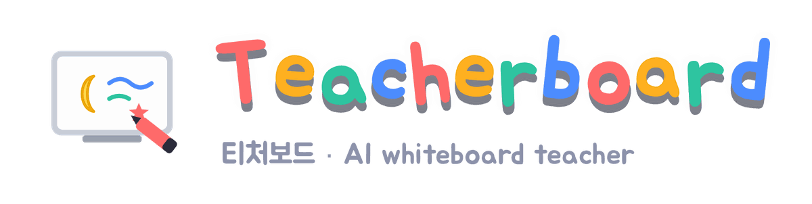
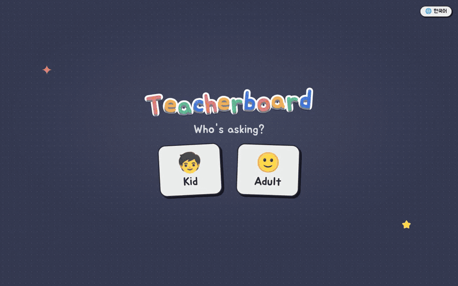
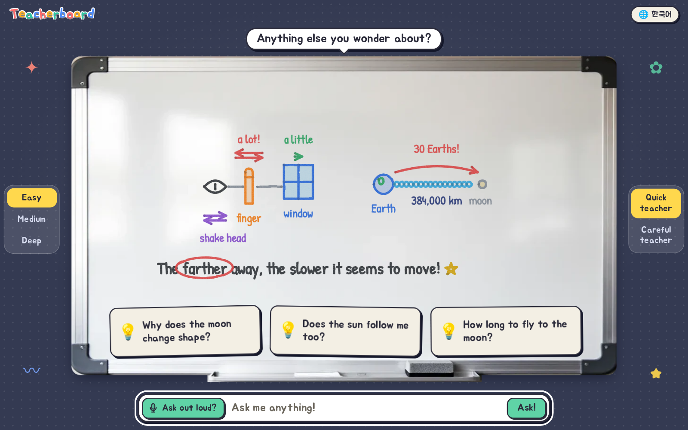
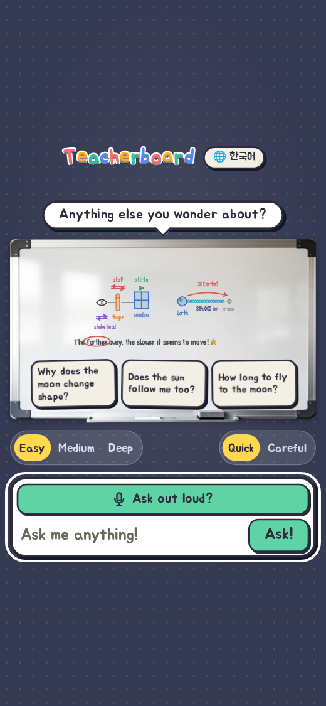
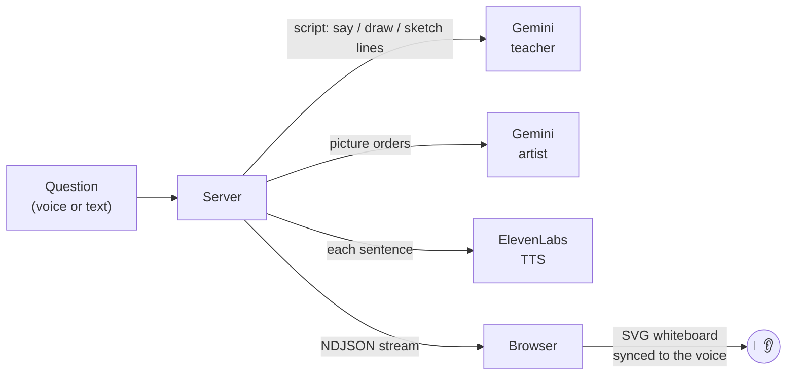

<p align="center">
  
</p>

<p align="center">
  <b>Ask anything. An AI teacher explains it out loud and draws it on a whiteboard — in sync with its voice.</b>
</p>

<p align="center">
  <b>English</b> · <a href="README.ko.md">한국어</a> · <a href="README.zh-CN.md">简体中文</a>
</p>

<p align="center">
  <a href="LICENSE"></a>
  
  
  
</p>

<p align="center">
  
</p>

<p align="center"><sub>Sped up 2×, no sound. ▶ <a href="docs/media/demo-en.mp4">Watch the full lesson with the teacher's voice (MP4)</a></sub></p>

---

## What it is

Teacherboard is a small web app for families. A kid (or a grown-up) asks a question by voice or text — *"Why does the moon follow me?"* — and a teacher at a whiteboard answers like a real lesson:

- **Talks and draws at the same time.** Each sentence is spoken while a marker writes the title, sketches pictures, draws arrows, and circles key words exactly when they are said.
- **Explaining pictures, not decoration.** A separate "artist" model draws side-by-side comparisons, cause → effect arrows, and cutaways that make the idea click.
- **Ask out loud and interrupt.** Speech recognition picks up real questions, ignores "wow!", sibling chatter, and the teacher's own voice, and lets you cut in with *"but why?"* mid-lesson.
- **Follow-up cards.** Every lesson ends with 2–3 tappable "what next?" questions.
- **English and Korean.** Switch with the 🌐 button; the screen, the lesson, the voice, and speech recognition all follow.
- **Made for kids.** Kid and adult profiles, three explanation levels (Easy / Medium / Deep), gentle handling of scary topics, and a family PIN when you open it to your phone.

<p align="center">
  
  &nbsp;
  
</p>

## How it works



1. The **teacher** model (Gemini) streams a lesson script as JSON Lines: sentences to say, board operations to draw, and orders for pictures.
2. The **artist** model draws each ordered picture as marker strokes, in parallel, while the lesson is already playing.
3. **ElevenLabs** voices each sentence with per-character timestamps, so drawing starts on the exact word (`"at": "mountains"`).
4. The browser plays it all back on an SVG whiteboard, stroke by stroke, at human hand speed.

Two teaching styles: **Quick teacher** (Gemini Flash, first words in ~2–3 s, the artist draws) and **Careful teacher** (a larger Gemini model thinks first, ~15–25 s, and draws every picture itself).

## Quick start

You need **Node.js 22+**, a **Gemini API key** ([Google AI Studio](https://aistudio.google.com/)), and an **ElevenLabs API key** with two voice IDs.

```bash
git clone https://github.com/doppingkim/teacherboard.git
cd teacherboard
npm install
cp .env.example .env      # then fill in the four required values
npm run dev               # → http://localhost:5173
```

`.env`:

```
GEMINI_API_KEY=...
ELEVENLABS_API_KEY=...
ELEVENLABS_VOICE_KID=...
ELEVENLABS_VOICE_ADULT=...
```

To try voices before choosing, generate samples (needs only `ELEVENLABS_API_KEY`) and listen to `data/samples/*.mp3`:

```bash
npx tsx scripts/voice-samples.ts <voiceId> <voiceId> ...
```

Want to see the board without any keys? Open `http://localhost:5173/?demo=1` for a fixed drawing demo.

### Production build

```bash
npm run build
npm start                 # → http://localhost:8787
```

### Docker

```bash
docker build -t teacherboard .
docker run --env-file .env -p 8787:8787 teacherboard
```

The container listens on `0.0.0.0`, so it refuses to start without `FAMILY_PIN` (see below).

## Use it on a phone or iPad

Browsers only allow the microphone on **HTTPS**. The easiest way is a tunnel from your computer:

**ngrok** (no app needed on the phone)

1. Get a free static domain at ngrok.com and run `ngrok config add-authtoken <token>` once.
2. Add to `.env`:
   ```
   ALLOWED_HOSTS=your-name.ngrok-free.app
   FAMILY_PIN=123456
   PIN_SECRET=<32+ random characters>
   TRUST_PROXY=1
   ```
3. `npm run build`, `npm start`, then in another terminal `ngrok http 8787 --url=your-name.ngrok-free.app`.
4. Open `https://your-name.ngrok-free.app` on the phone and "Add to Home Screen".

**Tailscale** works too: `tailscale serve --bg 8787`, then put the `<pc>.<tailnet>.ts.net` name in `ALLOWED_HOSTS`.

Over plain `http://<your-ip>:8787` you can still ask by typing.

### Family PIN

When the server is reachable from outside, a 6-digit `FAMILY_PIN` keeps your API keys from being used by strangers. Each device enters it once and is remembered for a year (set `PIN_SECRET` so restarts don't forget devices). Wrong guesses lock out per visitor, with global and daily limits on top. The server refuses to start without a PIN if `ALLOWED_HOSTS`, `TRUST_PROXY`, or a non-loopback `HOST` is set.

## Configuration

| Variable | Default | What it does |
| --- | --- | --- |
| `GEMINI_API_KEY` | — | **Required.** Teacher, artist, and speech classifier |
| `ELEVENLABS_API_KEY` | — | **Required.** Voice and speech recognition |
| `ELEVENLABS_VOICE_KID` / `_ADULT` | — | **Required.** Voice IDs per profile |
| `ELEVENLABS_VOICE_KID_EN` / `_ADULT_EN` | same as above | Different voices for English lessons |
| `PORT` | `8787` | Server port |
| `HOST` | `127.0.0.1` | `0.0.0.0` to open to other devices (needs `FAMILY_PIN`) |
| `FAMILY_PIN` | empty | 6-digit family PIN |
| `PIN_SECRET` | random per start | Cookie signing secret (32+ chars) |
| `TRUST_PROXY` | off | Trust a tunnel on this computer (ngrok, tailscale serve) |
| `ALLOWED_HOSTS` | empty | Extra host names, comma-separated |
| `LOG_TEXT` | on | `0` to log only the length of questions, not the text |
| `QUICK_MODEL` / `DEEP_MODEL` | `gemini-3.8-flash` / `gemini-4-neon` | Teacher models |
| `ARTIST_MODEL` | `gemini-3.8-flash` | Picture model |
| `CLASSIFY_MODEL` | `gemini-3.5-flash-lite` | "Is this a question?" model |

Each model also takes a thinking level: `QUICK_THINKING`, `DEEP_THINKING`, `ARTIST_THINKING`, `CLASSIFY_THINKING`.

## Language

The 🌐 button switches between English and 한국어 and is remembered per device. The first visit follows the browser language; `?lang=en` or `?lang=ko` in the address forces one. The choice changes the screen text, the board handwriting font, the lesson language, speech recognition, and the short "filler" lines played while the teacher thinks.

## Cost and privacy

- Each lesson is one teacher call, up to 5 artist calls, and one TTS call per sentence. Long system prompts are cached implicitly by Gemini.
- API keys stay on the server and are never sent to the browser or written to logs.
- The server logs each question so parents can see what was asked. Set `LOG_TEXT=0` to keep only character counts.
- `npx tsx scripts/latency-report.ts server.log --last 50` summarizes latency and usage from the logs.

## Development

```bash
npm test             # unit tests (Vitest)
npm run e2e          # browser tests (Playwright, with fixtures — no API calls)
npm run typecheck
```

Smoke tests against the real APIs live in `scripts/` (`smoke-teacher.ts`, `smoke-artist.ts`, `smoke-classify.ts`, `smoke-listen.ts`). Add `?fps=1` to the URL to see the drawing frame rate.

```
src/server   Fastify server: lesson stream, artist, TTS, speech recognition, family PIN
src/web      Browser: SVG whiteboard, player, microphone, UI
src/shared   Script format and types shared by both
```

## License

[MIT](LICENSE)
