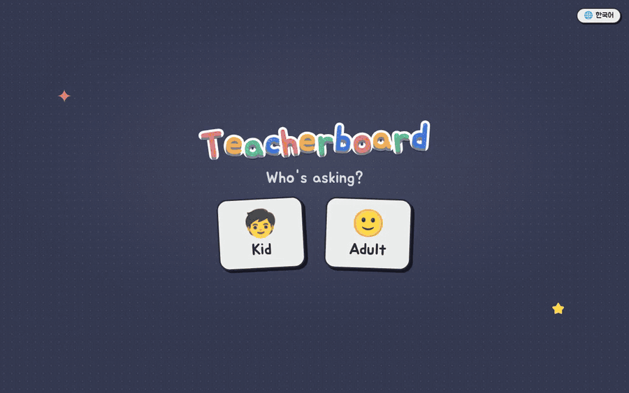
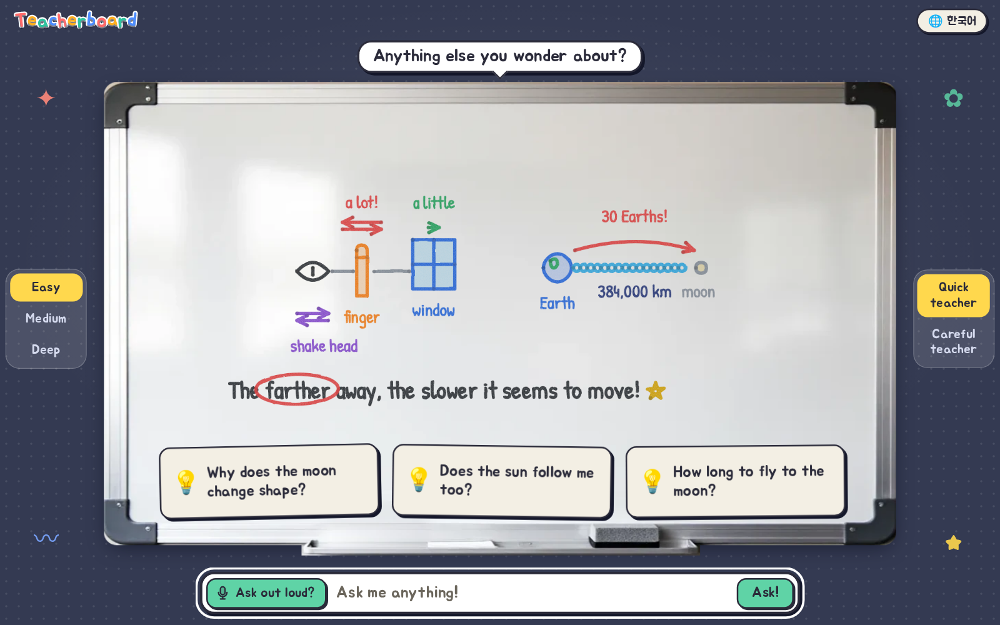
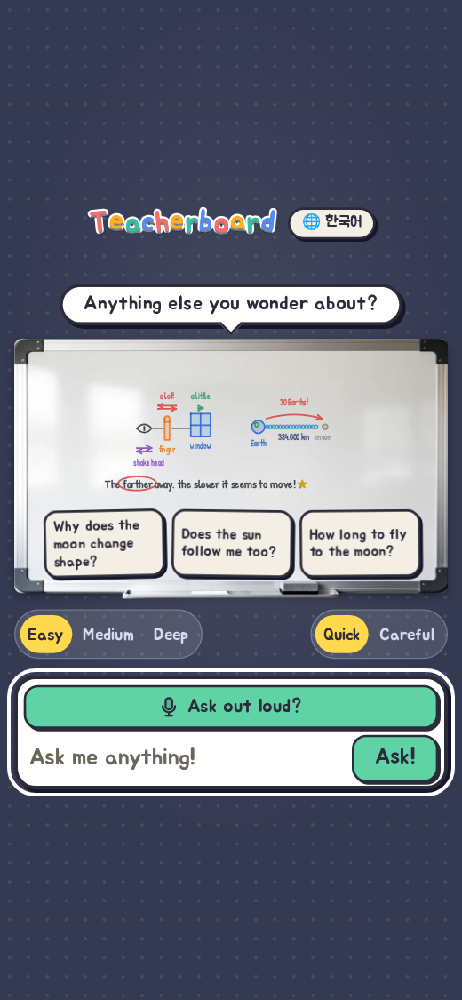
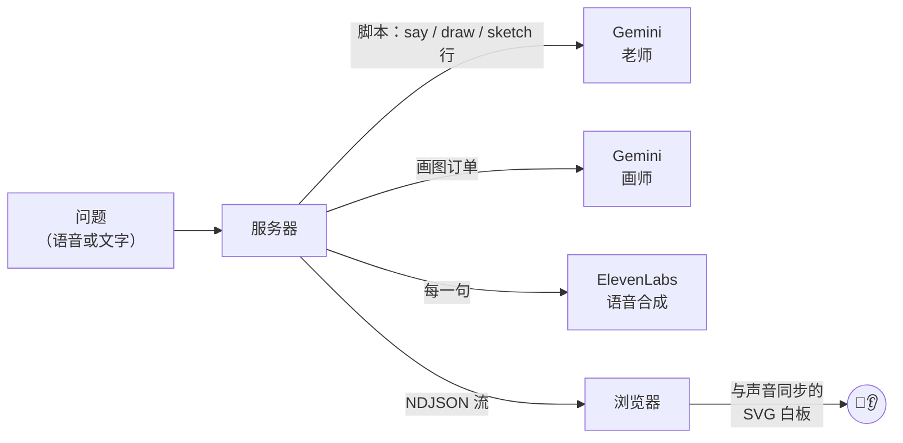

<p align="center">
  
</p>

<p align="center">
  <b>随便问一个问题，白板前的 AI 老师会一边讲解，一边在白板上画出来——画笔和声音同步。</b>
</p>

<p align="center">
  <a href="README.md">English</a> · <a href="README.ko.md">한국어</a> · <b>简体中文</b>
</p>

<p align="center">
  <a href="LICENSE"></a>
  
  
  
</p>

<p align="center">
  
</p>

<p align="center"><sub>2 倍速，无声音。▶ <a href="docs/media/demo-en.mp4">观看带老师语音的完整课程（MP4，英文）</a></sub></p>

> **课程语言：** 目前支持 **英语** 和 **韩语**（界面、讲解、语音和语音识别都会跟着切换）。暂不支持中文课程，欢迎贡献。

---

## 这是什么

Teacherboard 是一个面向家庭的小型 Web 应用。孩子（或大人）用语音或文字提问，例如 *"Why does the moon follow me?"*，白板前的老师会像真正上课一样回答：

- **边讲边画。** 每说一句话，马克笔就同步写标题、画图、画箭头，并在说到关键词的那一刻把它圈出来。
- **画的是"讲解图"，不是装饰画。** 独立的"画师"模型会画并排对比、因 → 果箭头、剖面图，让原理一眼就懂。
- **开口提问，随时打断。** 语音识别只接收真正的问题，会过滤"哇！"、兄弟姐妹的闲聊以及老师自己的声音；上课中可以随时插一句 *"可是为什么？"*。
- **追问卡片。** 每节课结束时会出现 2–3 个可点击的"接下来问什么"。
- **英语和韩语。** 用 🌐 按钮切换，界面、课程、语音和语音识别都会一起切换。
- **为孩子设计。** 儿童/成人两种身份，三个讲解难度（简单 / 中等 / 深入），温和处理可怕的话题；在手机上打开时有家庭密码保护。

<p align="center">
  
  &nbsp;
  
</p>

## 工作原理



1. **老师**模型（Gemini）以 JSON Lines 流式输出课程脚本：要说的句子、要画在白板上的内容，以及画图订单。
2. **画师**模型把每个订单画成马克笔线条，在课程开始后并行绘制。
3. **ElevenLabs** 为每句话生成语音和逐字时间戳，所以画笔会在准确的那个词开始落笔（`"at": "mountains"`）。
4. 浏览器在 SVG 白板上以真人手速一笔一笔地画出来。

两种老师：**快速老师**（Gemini Flash，约 2–3 秒开口，由画师作画）和 **细心老师**（更大的 Gemini 模型先思考约 15–25 秒，所有图都自己画）。

## 快速开始

需要 **Node.js 22+**、**Gemini API Key**（[Google AI Studio](https://aistudio.google.com/)）以及 **ElevenLabs API Key** 和两个声音 ID。

```bash
git clone https://github.com/doppingkim/teacherboard.git
cd teacherboard
npm install
cp .env.example .env      # 填写四个必填项
npm run dev               # → http://localhost:5173
```

`.env`：

```
GEMINI_API_KEY=...
ELEVENLABS_API_KEY=...
ELEVENLABS_VOICE_KID=...
ELEVENLABS_VOICE_ADULT=...
```

挑选声音前可以先生成试听样本（只需 `ELEVENLABS_API_KEY`），然后听 `data/samples/*.mp3`：

```bash
npx tsx scripts/voice-samples.ts <voiceId> <voiceId> ...
```

没有任何 Key 也想先看看白板？打开 `http://localhost:5173/?demo=1` 查看固定的绘图演示。

### 生产构建

```bash
npm run build
npm start                 # → http://localhost:8787
```

### Docker

```bash
docker build -t teacherboard .
docker run --env-file .env -p 8787:8787 teacherboard
```

容器监听 `0.0.0.0`，因此没有设置 `FAMILY_PIN` 时会拒绝启动（见下文）。

## 在手机或 iPad 上使用

浏览器只在 **HTTPS** 下允许使用麦克风。最简单的办法是从电脑开一个隧道：

**ngrok**（手机上无需安装应用）

1. 在 ngrok.com 申请免费的固定域名，并运行一次 `ngrok config add-authtoken <token>`。
2. 在 `.env` 中添加：
   ```
   ALLOWED_HOSTS=your-name.ngrok-free.app
   FAMILY_PIN=123456
   PIN_SECRET=<32 位以上的随机字符串>
   TRUST_PROXY=1
   ```
3. 运行 `npm run build`、`npm start`，再在另一个终端运行 `ngrok http 8787 --url=your-name.ngrok-free.app`。
4. 在手机上打开 `https://your-name.ngrok-free.app`，选择"添加到主屏幕"。

**Tailscale** 也可以：运行 `tailscale serve --bg 8787`，再把 `<pc>.<tailnet>.ts.net` 写进 `ALLOWED_HOSTS`。

通过普通的 `http://<电脑 IP>:8787` 访问时，只能用文字提问。

### 家庭密码

服务器对外开放时，6 位数字的 `FAMILY_PIN` 可以防止陌生人使用你的 API Key。每台设备输入一次后会记住一年（设置 `PIN_SECRET` 后重启服务器也不会忘记）。输错会按访问者锁定，另有全局和每日上限。只要设置了 `ALLOWED_HOSTS`、`TRUST_PROXY` 或非本机的 `HOST`，没有密码时服务器就不会启动。

## 配置

| 变量 | 默认值 | 说明 |
| --- | --- | --- |
| `GEMINI_API_KEY` | — | **必填。** 老师、画师、语音判别 |
| `ELEVENLABS_API_KEY` | — | **必填。** 语音合成与语音识别 |
| `ELEVENLABS_VOICE_KID` / `_ADULT` | — | **必填。** 各身份的声音 ID |
| `ELEVENLABS_VOICE_KID_EN` / `_ADULT_EN` | 同上 | 英语课程使用不同的声音 |
| `PORT` | `8787` | 服务器端口 |
| `HOST` | `127.0.0.1` | 设为 `0.0.0.0` 以对其他设备开放（需要 `FAMILY_PIN`） |
| `FAMILY_PIN` | 空 | 6 位家庭密码 |
| `PIN_SECRET` | 每次启动随机 | Cookie 签名密钥（32 位以上） |
| `TRUST_PROXY` | 关闭 | 信任本机上的隧道（ngrok、tailscale serve） |
| `ALLOWED_HOSTS` | 空 | 额外允许的主机名，用逗号分隔 |
| `LOG_TEXT` | 开启 | 设为 `0` 时日志只记录问题长度，不记录原文 |
| `QUICK_MODEL` / `DEEP_MODEL` | `gemini-3.8-flash` / `gemini-4-neon` | 老师模型 |
| `ARTIST_MODEL` | `gemini-3.8-flash` | 画师模型 |
| `CLASSIFY_MODEL` | `gemini-3.5-flash-lite` | "这是不是问题？"判别模型 |

每个模型还可以设置思考等级：`QUICK_THINKING`、`DEEP_THINKING`、`ARTIST_THINKING`、`CLASSIFY_THINKING`。

## 费用与隐私

- 每节课包含 1 次老师调用、最多 5 次画师调用，以及每句话 1 次语音合成。较长的系统提示会被 Gemini 隐式缓存。
- API Key 只保存在服务器上，不会发送到浏览器，也不会写入日志。
- 服务器会在日志中记录每个问题，方便家长查看；设置 `LOG_TEXT=0` 后只保留字数。
- `npx tsx scripts/latency-report.ts server.log --last 50` 可以从日志中汇总延迟与用量。

## 开发

```bash
npm test             # 单元测试（Vitest）
npm run e2e          # 浏览器测试（Playwright，使用固定数据，不调用 API）
npm run typecheck
```

调用真实 API 的冒烟测试在 `scripts/` 中（`smoke-teacher.ts`、`smoke-artist.ts`、`smoke-classify.ts`、`smoke-listen.ts`）。在地址后加 `?fps=1` 可以查看绘图帧率。

```
src/server   Fastify 服务器：课程流、画师、语音合成、语音识别、家庭密码
src/web      浏览器：SVG 白板、播放器、麦克风、界面
src/shared   双方共用的脚本格式与类型
```

## 许可证

[MIT](LICENSE)
